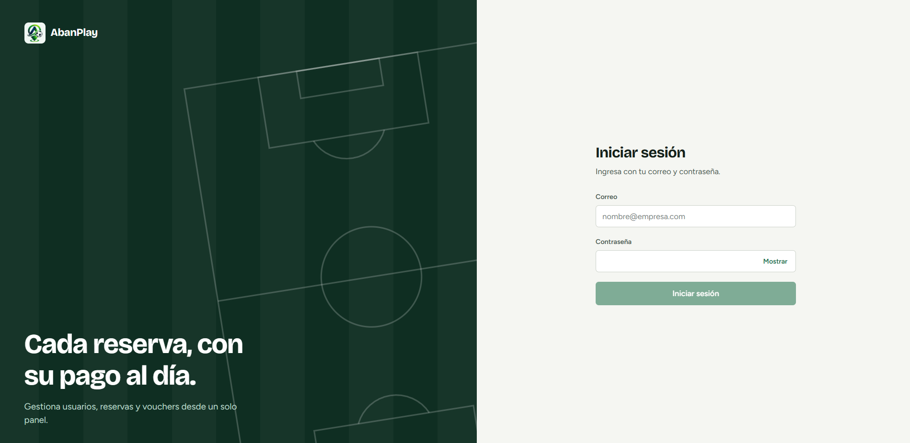

<div align="center">

  

  # ⚽ AbanPlay

  **Plataforma de gestión de complejos deportivos, reservas y administración.**

  [](https://reactjs.org/)
  [](https://vitejs.dev/)
  [](https://developer.mozilla.org/es/docs/Web/JavaScript)
  [](#)

  <p align="center">
    <i>Cada reserva, con su pago al día. Gestiona usuarios, reservas y vouchers desde un solo panel.</i>
  </p>

  <br />

  

</div>

---

## 🚀 Sobre el Proyecto

**AbanPlay** es un panel web administrativo moderno construido con **React** y **Vite**, diseñado para centralizar y simplificar la gestión de canchas y complejos deportivos en Abancay. Permite administrar de manera fluida roles de usuarios, asignación de complejos, seguimiento de reservas y reportes generales del sistema.

---

## ✨ Características Principales

- 🔐 **Autenticación y Control de Acceso:** Inicio de sesión seguro con control de vistas según el rol (Super Admin / Administrador de Complejo).
- 🏟️ **Gestión de Complejos:** Alta, edición y carga multimedia (fotografías) para cada complejo deportivo.
- 👥 **Administración de Usuarios y Personal:** Asignación y gestión de administradores por cada cancha/complejo.
- 📊 **Reportes y Métricas:** Panel general de indicadores con información consolidada en tiempo real.
- ⚡ **Interfaz Rápida y Adaptable:** Desarrollado con Vite para tiempos de carga inmediatos y navegación fluida.

---

## 🛠️ Tecnologías Utilizadas

- **Frontend:** React + Vite
- **Estado y Peticiones:** TanStack Query (React Query)
- **Estilos:** CSS3 / Tailwind CSS (según configuración)
- **API backend:** RESTful API

---

## 💻 Guía de Instalación y Arranque

```bash
cp .env.example .env   
npm install
npm run dev
```